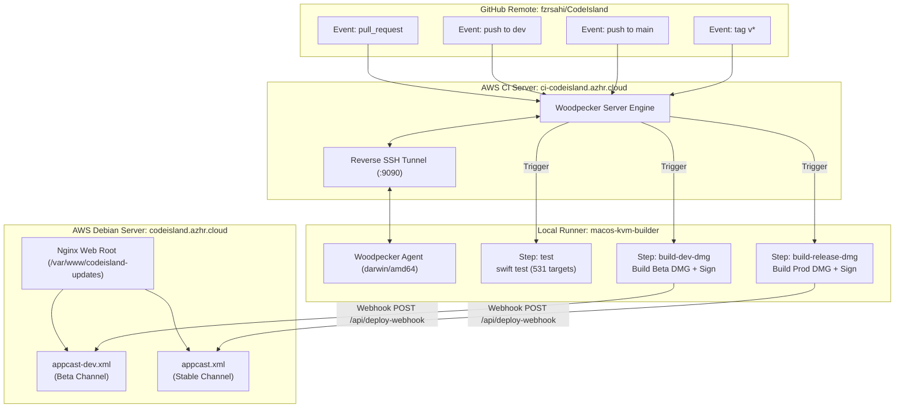
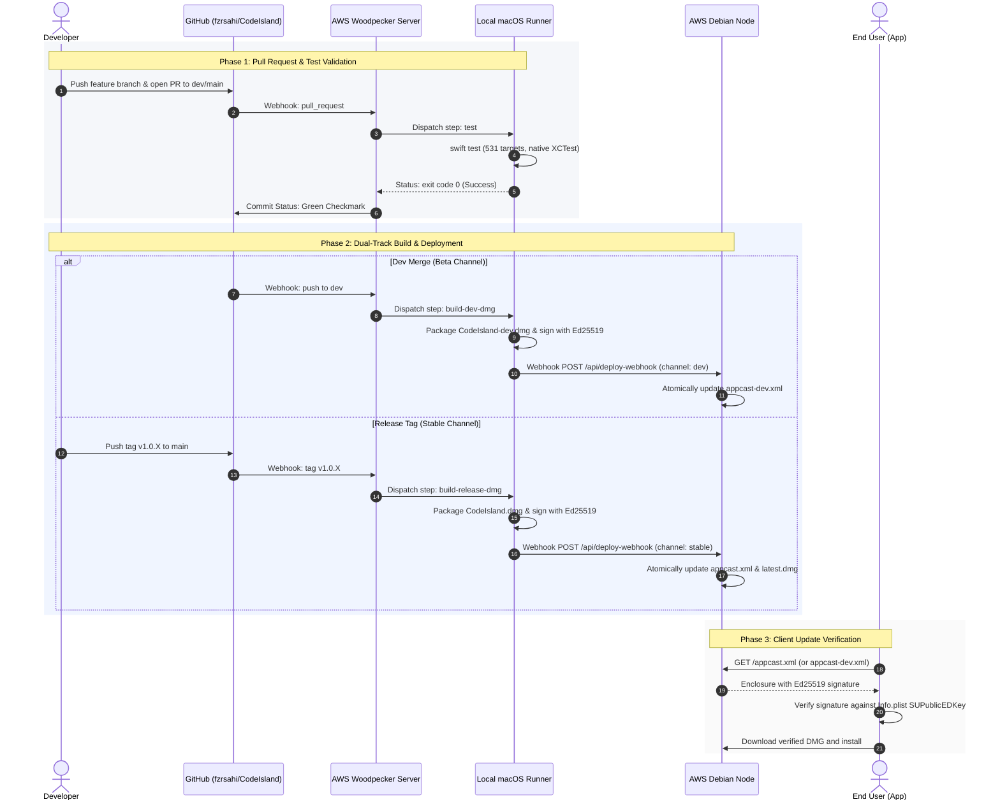

# CodeIsland Distribution Node & CI/CD Deployment

This guide documents the architecture, automated deployment pipelines, and node setup required to distribute CodeIsland updates via self-hosted Debian infrastructure and Sparkle auto-updates.

---

## 1. Architecture Overview

CodeIsland operates a zero-cost, self-hosted build and distribution pipeline:
- **Build Runner:** Local KVM-accelerated macOS Sonoma VM (`macos-kvm-builder`) on AMD Ryzen hardware, eliminating cloud macOS runner costs.
- **Orchestration:** Self-hosted Woodpecker CI Server (`ci-codeisland.azhr.cloud`) connected to the local runner over a persistent reverse SSH tunnel.
- **Distribution Node:** Debian server (`codeisland.azhr.cloud`) fronted by Cloudflare Tunnel and Nginx, serving signed DMGs and Sparkle XML feeds.



---

## 2. End-to-End Release Sequence



---

## 3. Debian Server Setup

### 1. Run Node Setup Script
Copy the `deploy/debian/` directory to the Debian server and execute:

```bash
sudo ./deploy/debian/setup-debian-node.sh
```

The script performs the following tasks:
- Installs `webhook`, `curl`, and `jq`.
- Creates `/var/www/codeisland-updates/releases/` with `www-data` ownership.
- Generates a cryptographically random 32-character `WEBHOOK_SECRET`.
- Configures and starts the systemd service `codeisland-webhook.service` on `127.0.0.1:9000`.

> [!IMPORTANT]
> Record the `WEBHOOK_SECRET` printed at the end of the script output. It is stored in Woodpecker CI Server secrets as `codeisland_webhook_secret`.

---

### 2. Configure Nginx
Copy the Nginx configuration template to `sites-available`:

```bash
sudo cp deploy/debian/nginx-updates.conf /etc/nginx/sites-available/codeisland-updates.conf
```

Edit the file to set the `server_name` to match your designated Cloudflare Tunnel domain:

```bash
sudo nano /etc/nginx/sites-available/codeisland-updates.conf
# Set: server_name codeisland.azhr.cloud;
```

Enable the configuration and reload Nginx:

```bash
sudo ln -s /etc/nginx/sites-available/codeisland-updates.conf /etc/nginx/sites-enabled/
sudo nginx -t
sudo systemctl reload nginx
```

---

### 3. Cloudflare Tunnel Routing
Ensure your Cloudflare Zero Trust tunnel configuration routes the designated hostname to the local Nginx instance on port 80:

```yaml
ingress:
  - hostname: codeisland.azhr.cloud
    service: http://localhost:80
  - service: http_status:404
```

---

## 4. Secret Configuration (Woodpecker CI)

Secrets are securely maintained in Woodpecker Server (`https://ci-codeisland.azhr.cloud/fzrsahi/CodeIsland/settings/secrets`):

| Secret Name | Description | Scope |
|---|---|---|
| `codeisland_webhook_secret` | Shared secret token for `/api/deploy-webhook` | Injected into `build-dev-dmg` & `build-release-dmg` |
| `sparkle_private_key` | Ed25519 private key used to sign DMG releases | Injected in-memory to `sign_update` |

---

## 5. Release Execution & Verification

### Production Release (Stable)
Push a semantic version tag to `main`:
```bash
git tag v1.0.41
git push origin v1.0.41
```
The CI runner will compile universal arm64/x86_64 binaries, assemble `CodeIsland.dmg`, sign with the Ed25519 key, and update `https://codeisland.azhr.cloud/appcast.xml`.

### Development Release (Beta)
Merge any pull request into the `dev` branch. The runner automatically packages `CodeIsland-dev.dmg` and publishes the pre-release item to `https://codeisland.azhr.cloud/appcast-dev.xml`.

---

## 6. Monitoring and Logs on Debian

### Standalone Daemon (Systemd)
```bash
journalctl -u codeisland-webhook.service -f
```

### Docker Containerized Node (`codeisland-node`)
```bash
# View real-time webhook & ingress logs
docker logs -f codeisland-node

# Inspect resource utilization (RAM capped at 64MB)
docker stats --no-stream codeisland-node

# Inspect releases directory
docker exec codeisland-node ls -la /data/releases/
```

Verify the Sparkle update feed endpoint:
```bash
curl -I https://codeisland.azhr.cloud/appcast.xml
curl -I https://codeisland.azhr.cloud/appcast-dev.xml
```
