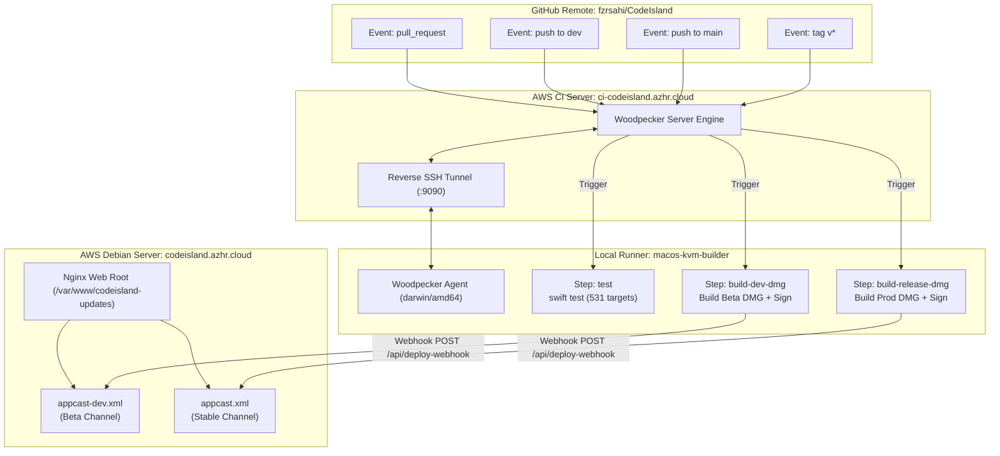
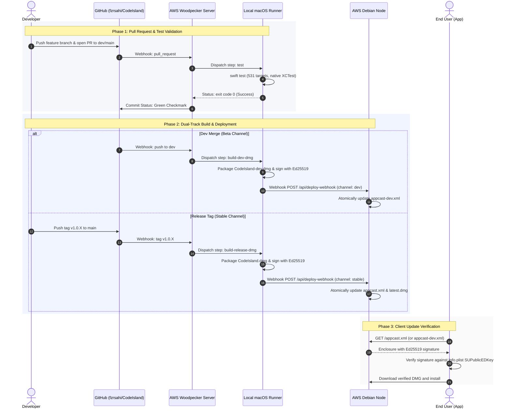

# CodeIsland Distribution Node & CI/CD Deployment

This guide documents the architecture, automated deployment pipelines, and node setup required to distribute CodeIsland updates via self-hosted Debian infrastructure and Sparkle auto-updates.

---

## 1. Architecture Overview

CodeIsland operates a zero-cost, self-hosted build and distribution pipeline:
- **Build Runner:** Local KVM-accelerated macOS Sonoma VM (`macos-kvm-builder`) on AMD Ryzen hardware, eliminating cloud macOS runner costs.
- **Orchestration:** Self-hosted Woodpecker CI Server (`ci-codeisland.azhr.cloud`) connected to the local runner over a persistent reverse SSH tunnel.
- **Distribution Node:** Debian server (`codeisland.azhr.cloud`) fronted by Cloudflare Tunnel and Nginx, serving signed DMGs and Sparkle XML feeds.



---

## 2. End-to-End Release Sequence



---

## 3. Debian Server Setup

### 1. Run Node Setup Script
Copy the `deploy/debian/` directory to the Debian server and execute:

```bash
sudo ./deploy/debian/setup-debian-node.sh
```

The script performs the following tasks:
- Installs `webhook`, `curl`, and `jq`.
- Creates `/var/www/codeisland-updates/releases/` with `www-data` ownership.
- Generates a cryptographically random 32-character `WEBHOOK_SECRET`.
- Configures and starts the systemd service `codeisland-webhook.service` on `127.0.0.1:9000`.

> [!IMPORTANT]
> Record the `WEBHOOK_SECRET` printed at the end of the script output. It is stored in Woodpecker CI Server secrets as `codeisland_webhook_secret`.

---

### 2. Configure Nginx
Copy the Nginx configuration template to `sites-available`:

```bash
sudo cp deploy/debian/nginx-updates.conf /etc/nginx/sites-available/codeisland-updates.conf
```

Edit the file to set the `server_name` to match your designated Cloudflare Tunnel domain:

```bash
sudo nano /etc/nginx/sites-available/codeisland-updates.conf
# Set: server_name codeisland.azhr.cloud;
```

Enable the configuration and reload Nginx:

```bash
sudo ln -s /etc/nginx/sites-available/codeisland-updates.conf /etc/nginx/sites-enabled/
sudo nginx -t
sudo systemctl reload nginx
```

---

### 3. Cloudflare Tunnel Routing
Ensure your Cloudflare Zero Trust tunnel configuration routes the designated hostname to the local Nginx instance on port 80:

```yaml
ingress:
  - hostname: codeisland.azhr.cloud
    service: http://localhost:80
  - service: http_status:404
```

---

## 4. Secret Configuration (Woodpecker CI)

Secrets are securely maintained in Woodpecker Server (`https://ci-codeisland.azhr.cloud/fzrsahi/CodeIsland/settings/secrets`):

| Secret Name | Description | Scope |
|---|---|---|
| `codeisland_webhook_secret` | Shared secret token for `/api/deploy-webhook` | Injected into `build-dev-dmg` & `build-release-dmg` |
| `sparkle_private_key` | Ed25519 private key used to sign DMG releases | Injected in-memory to `sign_update` |
| `github_token` | GitHub API Personal Access Token (classic `repo:status` or fine-grained) | Injected into `test` & `report-pr-failure` |

---

## 5. Woodpecker CI Server GitHub Status Reporting & Rulesets Integration

### 1. Root Cause Analysis: Why Checks Were Missing in GitHub Rulesets
1. **Commit Status API vs Checks API**: Woodpecker CI (v2.8.3) integrates with GitHub via the **Commit Statuses API** (`POST /repos/{owner}/{repo}/statuses/{sha}`), not the GitHub Checks API (Check Runs).
   * Commit statuses appear on the **Conversation** tab (merge box at the bottom of the PR), **not** in the PR "Checks" tab (which is reserved exclusively for GitHub Apps).
   * **GitHub Branch Rulesets fully support Commit Statuses.** The absence of entries in the Checks tab does not prevent status check enforcement.
2. **Event-Variable Mismatch in Context Name**: By default, Woodpecker generates context names with `{{ .event }}`:
   * Push to `main`: `ci/woodpecker/push/woodpecker`
   * Pull Request: `ci/woodpecker/pr/woodpecker`
   Because GitHub Rulesets for `main` only index checks that have been reported to `main`, `ci/woodpecker/pr/woodpecker` is not surfaced in the `main` ruleset picker unless searched explicitly or configured with a stable context format.

### 2. Recommended Server-Side Configuration (AWS EC2 Woodpecker Server)
To ensure Woodpecker reports an identical, event-independent status context across both PRs and direct pushes, configure the following environment variable on the Woodpecker server (`ci-codeisland.azhr.cloud`):

```bash
# In Woodpecker Server environment file (e.g. /etc/woodpecker/server.env or docker-compose.yml):
WOODPECKER_STATUS_CONTEXT=ci/woodpecker
WOODPECKER_STATUS_CONTEXT_FORMAT="{{ .context }}/{{ .workflow }}"
```

With this setting:
- On `push`: Woodpecker reports `ci/woodpecker/woodpecker`
- On `pull_request`: Woodpecker reports `ci/woodpecker/woodpecker`

Restart Woodpecker Server to apply:
```bash
sudo systemctl restart woodpecker-server
# or: docker compose restart woodpecker-server
```

### 3. Configuring GitHub Branch Rulesets
1. In the GitHub repository, navigate to **Settings > Rules > Rulesets**.
2. Select your branch protection ruleset for `main` (or click **New ruleset > New branch ruleset**).
3. Under **Rules**, enable **Require status checks to pass before merging**.
4. In the **Required status checks** section, click **+ Add checks**.
5. In the search box, search for:
   * **`CodeIsland / XCTest Core Harness`** (Recommended: verifies all 1,098 unit tests pass; stable across all events)
   * **`ci/woodpecker/pr/woodpecker`** (or `ci/woodpecker/woodpecker` / `ci/woodpecker` after server format update)
6. Select the status check, check **Do not require branches to be up to date before merging** (or enable strict mode if preferred), and click **Save changes**.

### 4. Verification CLI Tool
Maintainers can verify live GitHub commit statuses for any commit or PR using:
```bash
python3 ./scripts/verify-ci-status.py --sha HEAD
```

---

## 6. Release Execution & Verification

### Production Release (Stable)
Push a semantic version tag to `main`:
```bash
git tag v1.0.41
git push origin v1.0.41
```
The CI runner will compile universal arm64/x86_64 binaries, assemble `CodeIsland.dmg`, sign with the Ed25519 key, and update `https://codeisland.azhr.cloud/appcast.xml`.

### Development Release (Beta)
Merge any pull request into the `dev` branch. The runner automatically packages `CodeIsland-dev.dmg` and publishes the pre-release item to `https://codeisland.azhr.cloud/appcast-dev.xml`.

---

## 6. Monitoring and Logs on Debian

### Standalone Daemon (Systemd)
```bash
journalctl -u codeisland-webhook.service -f
```

### Docker Containerized Node (`codeisland-node`)
```bash
# View real-time webhook & ingress logs
docker logs -f codeisland-node

# Inspect resource utilization (RAM capped at 64MB)
docker stats --no-stream codeisland-node

# Inspect releases directory
docker exec codeisland-node ls -la /data/releases/
```

Verify the Sparkle update feed endpoint:
```bash
curl -I https://codeisland.azhr.cloud/appcast.xml
curl -I https://codeisland.azhr.cloud/appcast-dev.xml
```
