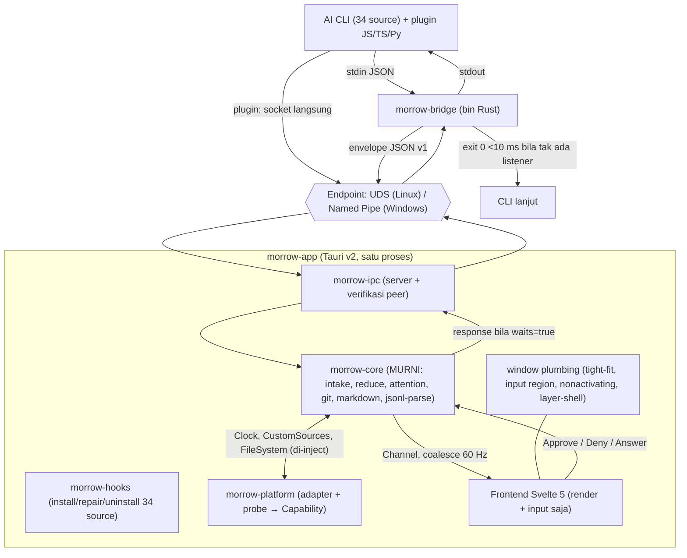

# Rencana Arsitektur Windows & Linux — Tauri v2 + Rust

**Status:** rencana yang berlaku. Dibuat 2026-11-16, direvisi 2026-11-18 (rebrand Morrow, koreksi click-through, adapter yang hilang, kontrak socket, layout monorepo, Opsi E).

**Keputusan yang mendasari:** Windows + Linux dibangun sebagai **satu shell Tauri v2** di atas **satu core**, dihubungkan lewat **kontrak hook JSON yang dibekukan**. macOS tetap SwiftUI/AppKit. Default bahasa core Windows/Linux adalah **Rust**; Opsi E (core Swift yang sama dengan macOS, dijalankan sebagai sidecar) diuji dulu lewat eksperimen 1–2 hari sebelum PR workspace Rust (lihat §7 Fase 0.5). Alasannya ada di [ADR-0001](adr/0001-two-cores-one-contract.md) dan [ADR-0002](adr/0002-tauri-v2-shell.md).

---

## 0. Peta dokumen — baca ini dulu

Yang berlaku **hanya satu** daftar fase: **§7 di bawah, identik dengan "Urutan Implementasi" di [#33](https://github.com/fzrsahi/Morrow/issues/33).** Kalau berbeda, itu bug — perbaiki keduanya bersamaan.

| Dokumen | Perannya | Cari di sini kalau… |
|---|---|---|
| [`GLOSSARY.md`](../GLOSSARY.md) | Kosakata kanonik | bingung Source vs Agent vs Hook target |
| [`adr/0001`](adr/0001-two-cores-one-contract.md) | Keputusan: dua core, satu kontrak (+ amandemen Opsi E) | "kenapa bukan satu core?" |
| [`adr/0002`](adr/0002-tauri-v2-shell.md) | Keputusan: Tauri (bukan .NET, bukan mygo) | "kenapa bukan WPF / Avalonia / mygo?" |
| **dokumen ini** | Arsitektur + **fase kanonik (§7)** | modul, seam, adapter, urutan kerja |
| [#33](https://github.com/fzrsahi/Morrow/issues/33) | Urutan + alasan urutan | "kenapa Linux dulu?" |
| [#47](https://github.com/fzrsahi/Morrow/issues/47) | Scope Windows, item W0–W7, acceptance W-001…W-009 | detail kerja Windows |
| [#48](https://github.com/fzrsahi/Morrow/issues/48) | Scope Linux, item L0–L7, acceptance L-001…L-012 | detail kerja Linux |
| [#70](https://github.com/fzrsahi/Morrow/issues/70) | Pipeline CI multiplatform + distribusi | runner, path filter, mirror EC2 |
| [`handoff-windows-linux-port.md`](handoff-windows-linux-port.md) | Indeks + daftar jebakan + siapa mengerjakan apa | mulai dari mana, apa yang menipu |
| [`progress-windows-linux-port.md`](progress-windows-linux-port.md) | Papan status + log checkpoint | fase mana yang jalan, apa blocker-nya |
| [`research-mygo-vs-tauri.md`](research-mygo-vs-tauri.md) | Bukti primer + pengukuran. **§9 usang** (rekomendasi Go/mygo) | angka mentah di balik ADR |
| [`archive/linux-avalonia-plan.md`](archive/linux-avalonia-plan.md) | **Usang** — rencana Avalonia lama | acceptance L-001…L-012, analisis risiko Wayland |
| [`windows/Morrow-Windows-Complete-Development-Plan.md`](../windows/Morrow-Windows-Complete-Development-Plan.md) | **Usang** — rencana WPF | riwayat saja |

**Aturan korelasi.** `W#` dan `L#` di #47/#48 adalah **item kerja lokal, bukan urutan**. Urutan yang mengikat adalah fase di §7.

---

## 1. Keputusan

| Lapisan | Pilihan | Alasan |
|---|---|---|
| Shell Windows/Linux | **Tauri v2** (Rust + webview OS) | Satu shell untuk dua OS. 46 view SwiftUI (23 mascot) jauh lebih murah direproduksi di CSS/Canvas daripada di toolkit native |
| Core Windows/Linux | **Rust** (`morrow-core`) — *default, dikonfirmasi oleh eksperimen Fase 0.5* | Satu toolchain dengan shell; `windows` crate memberi WinRT lengkap (SMTC, Geolocation); `btleplug` untuk ESP32 |
| Bridge Windows/Linux | **Rust** (`morrow-bridge`) | Satu toolchain. 4,49 ms median (terukur) — setara Swift 5,3 ms. Bukan argumen performa |
| Frontend | **Svelte 5 + CSS + Canvas** | Rune untuk state, runtime kecil, spring via `svelte/motion` |
| macOS | **Tidak berubah** — SwiftUI/AppKit + `MorrowCore` (Swift, 21.699 LOC, 73 file) | 20.177 LOC test core + test app hijau; rewrite = risiko tanpa hasil |
| Transport | UDS (Linux, macOS) / Named Pipe (Windows) | Seam proses sudah ada dan terbukti di macOS |

**Kenapa bukan .NET untuk Windows.** Bukan karena Tauri lebih hemat memori — itu **tidak terbukti** dan kemungkinan salah: WebView2 menjalankan satu process group (browser + renderer + GPU + utility), dan belum ada pengukuran kredibel WPF vs Tauri yang bisa dikutip. Alasan sebenarnya:

1. **Satu shell untuk Windows dan Linux.** WPF hanya Windows; jalur .NET lintas OS adalah Avalonia, yang tetap menuntut UI ditulis ulang.
2. **Core C# yang ada justru yang divergen** (`cursor_version`, lihat ADR-0001) dan kecil (~1,5K LOC portabel vs `MorrowCore` 21,7K) — tidak ada aset besar yang hilang.
3. **Paritas visual.** Pixel HUD, spectrum, floating lyrics, git spine graph — semuanya Canvas/CSS di web; di WPF/Avalonia setiap view adalah kerja native baru.

Memori **diukur** di W4/L4 (gate RSS <150 MB). Kalau gagal jauh, itu input untuk ADR baru, bukan alasan diam-diam ganti stack.

---

## 2. Mengapa dua core, dan kapan bisa jadi satu

Kontrak bersama adalah satu-satunya yang wajib stabil:

```
        ┌──────────────────────────────────────────────┐
        │  KONTRAK (shared/contract/)                  │
        │  hook-edge-protocol.md · schemas/*.json      │
        │  fixtures/{neutral,macos,linux,windows}      │
        │  + kontrak path socket/pipe (§3.1)           │
        └───────┬──────────────────────┬───────────────┘
                │                      │
        ┌───────▼────────┐    ┌────────▼──────────────┐
        │ macOS          │    │ Windows + Linux       │
        │ MorrowCore     │    │ morrow-core (Rust)    │
        │ Swift 21,7K    │    │ ATAU MorrowCore Swift │
        │                │    │ sebagai sidecar (E)   │
        └───────┬────────┘    └────────┬──────────────┘
        ┌───────▼────────┐    ┌────────▼──────────────┐
        │ SwiftUI/AppKit │    │ Tauri v2 + Svelte     │
        │ NSPanel notch  │    │ pill overlay          │
        └────────────────┘    └───────────────────────┘
```

**Koreksi premis lama.** Versi pertama ADR-0001 menyatakan "satu core untuk tiga OS mustahil selama macOS tetap Swift". Itu hanya benar kalau core bersama harus bukan Swift. Kode tidak mendukung "mustahil":

- `MorrowCore` tidak bergantung pada app (`Package.swift`: target tanpa dependensi) dan **tidak punya satu pun `#if os`**.
- Dari 73 file, ~13 butuh shim. Yang benar-benar sulit di Linux hanya `JSONLTailer` (`DispatchSource.makeFileSystemObjectSource`, tidak ada di libdispatch non-Darwin). Windows menambah AF_UNIX/`getpeereid`/`fchmod`/`O_NOFOLLOW` di `SocketPath`, `PrivateFiles`, `BridgeLog`, `AiWorkWatchClient`.
- Biayanya nyata: runtime Swift harus dikirim di Windows, Foundation di Windows lebih rapuh, dan core↔shell menjadi IPC (sidecar JSON-lines), bukan in-process. Preseden produksi: [DigUp](https://github.com/ARahim3/DigUp) (engine Swift + shell Tauri di Windows/Linux).

Keputusan Rust vs Opsi E diambil dari **eksperimen**, bukan argumen (§7 Fase 0.5). Selama eksperimen belum jalan, Rust adalah default.

---

## 3. Topologi proses



Dua binary, satu proses app. Core adalah library in-process (Rust). Pada Opsi E, `morrow-core` diganti sidecar Swift yang bicara JSON-lines ke shell; topologi lainnya tidak berubah.

### 3.1 Kontrak endpoint (baru — wajib dibekukan di Fase 0.5)

Hari ini path socket tersebar di Swift, Python, dan empat plugin JS/TS, dan **sudah divergen** (lihat §12, regresi rebrand). Endpoint harus menjadi bagian kontrak, satu aturan untuk semua edge:

| OS | Endpoint | Verifikasi |
|---|---|---|
| macOS | `MORROW_SOCKET_PATH` ?? `CODEISLAND_SOCKET_PATH` ?? `/tmp/morrow-<uid>.sock` (fallback legacy `/tmp/codeisland-<uid>.sock` bila hanya itu yang ada) — `SocketPath.swift:5-15` | `lstat` pemilik + `getpeereid` (sudah ada) |
| Linux | `MORROW_SOCKET_PATH` ?? `$XDG_RUNTIME_DIR/morrow/island.sock` ?? `/tmp/morrow-<uid>.sock` | `lstat` pemilik + parent dir `0700`; `SO_PEERCRED` setelah connect; probe-connect sebelum unlink socket basi |
| Windows | `\\.\pipe\morrow-<SID>` (format `windows/Morrow.Ipc/PipeEndpoint.cs:14`) | server: `first_pipe_instance(true)` + `reject_remote_clients(true)` + DACL hanya user ini; client: `GetNamedPipeServerProcessId` → token → bandingkan SID |

Catatan keamanan: `PipeEndpoint.CreateServer` di C# tidak memakai `PipeSecurity`/`CurrentUserOnly` dan client tidak memverifikasi server. Nama pipe bisa ditebak, jadi pipe bisa di-*squat* — ancaman yang sama yang dijaga `SocketPath.Holder` di macOS. Implementasi Rust wajib menutupnya.

Plugin Node bisa `net.connect` ke `\\.\pipe\…` apa adanya; plugin Python butuh `open(r'\\.\pipe\…', 'r+b')`. Resolusi endpoint di plugin dilakukan **saat kirim**, bukan saat modul dimuat (agent yang jalan lebih dulu dari app).

---

## 4. Layout monorepo (disetujui di #48)

```
Cargo.toml                 # workspace Rust (Cargo mengharuskan member di bawah root workspace)
macos/                     # Package.swift, Package.resolved, Sources/, Tests/, Info.plist,
                           # Morrow.entitlements, Assets.xcassets, AppIcon.icon, appcast.xml,
                           # build.sh, scripts/ khusus macOS
shared/
  contract/                # hook-edge-protocol.md, schemas/, fixtures/{neutral,macos,linux,windows}
  hook-plugins/            # js/ts/py yang sekarang di Sources/Morrow/Resources — dipakai 3 OS
  protocol/ble/            # UUID + format Buddy (kini disalin manual di Swift, .ino, Kotlin, C#)
  crates/
    morrow-protocol/       # envelope, serde, versioning
    morrow-core/           # MURNI. CI menolak dependensi OS
    morrow-ipc/            # UDS | named pipe + verifikasi peer
    morrow-platform/       # trait + impl per-OS (#[cfg])
    morrow-hooks/          # deteksi + install/uninstall hook
    morrow-bridge/         # bin
  desktop/                 # app Tauri v2 (src-tauri/ + src/ Svelte 5) — Windows + Linux
linux/                     # packaging deb/rpm/AppImage, .desktop, skrip CI Linux
windows/                   # packaging NSIS, signing; C# lama → windows/legacy-dotnet/ sampai Fase 6
companions/                # ios/, android-watch/, hardware/ (opsional; boleh tetap di root)
deploy/  docs/  .woodpecker.yaml  .githooks/
```

Linux dan Windows **tidak** punya kode shell sendiri: satu `shared/desktop` + `#[cfg]` di `morrow-platform`. Folder `linux/` dan `windows/` hanya packaging dan hal yang benar-benar khusus OS.

**Path yang rusak saat pindah — wajib diperbaiki di PR pindah yang sama:**

| Lokasi | Ketergantungan |
|---|---|
| `scripts/build-dmg.sh:19,85-123,208,248,331`, `update-appcast.sh:31-40` | `REPO_ROOT/..`, `Info.plist`, `Assets.xcassets`, `appcast.xml` di root |
| `build.sh`, `swiftpm-release.sh`, `run-xctest-runner.py:100-113`, `perf/bench.sh` | cwd = root paket Swift |
| `.githooks/pre-push:15` | `swift build` di root |
| `.woodpecker.yaml:33,70-145` | `./scripts/…`, `.build/Morrow.dmg`, `appcast.xml` |
| `ios/MorrowCompanion/project.yml:22-41,…` + `project.pbxproj:371` | `../../Sources/Morrow/*View.swift` |
| `Tests/Morrow*PluginTests/*.test.ts` | import `../../Sources/Morrow/Resources/…` |
| `deploy/debian/deploy-morrow.sh:77` | `raw.githubusercontent.com/…/main/appcast.xml` |
| `docs/hook-edge-protocol.md:9,286` | path `Sources/MorrowCore/…` |

Urutan: rebase & merge #49–#52 → **satu PR khusus `git mv` + perbaikan path** (one-way door, nol perubahan perilaku; bukti: `swift test` + DMG build hijau) → baru PR workspace Rust, supaya kode baru lahir di lokasi akhirnya.

**Aturan CI yang mengikat:** `cargo tree -p morrow-core -e normal` tidak boleh memuat `windows`, `windows-sys`, `libc`, `nix`, `zbus`, `btleplug`, `tokio` (fitur `process`/`net`/`fs`), atau crate yang memanggil `std::process`. Tanpa aturan ini "core murni" bocor dalam dua minggu.

---

## 5. Pembagian tanggung jawab

### 5.1 `morrow-core` — murni, portabel, tanpa OS

Di-port dari Swift, **bukan didesain ulang**, supaya conformance test bermakna.

| Modul Swift (`Sources/MorrowCore`) | LOC | Catatan |
|---|---|---|
| `SessionSnapshot.swift` → `reduceHookEvent` (`:1143`) / `applyHookEvent` / `SideEffect` | 2.560 (file) | **Hampir** murni: `Date()` dipanggil di banyak tempat (`:1272, 1312, 1596, …`) dan `UserDefaults.standard` dibaca di `loadCustomSources` (`:451, 463`). Port Rust wajib meng-inject `Clock` dan `CustomSources`, atau conformance flaky |
| `AttentionPolicy.swift` (termasuk `HookEventFacts` `:316`) | 578 | Murni |
| `HookIntake.swift` | 717 | **Murni dengan fakta di-inject** — hanya `import Foundation`; semua lookup proses masuk lewat closure `Facts` (`:13-15`). **Masuk core.** Panggilan OS (`proc_pidpath`, `/dev/tty`, `sysctl`) ada di `Sources/MorrowBridge/main.swift:41-114` |
| `HookEdgeFacts` | 107 | Murni |
| `GitBranchReader.swift` | 79 | Baca `.git` dengan `FileManager`; `parseHEAD`/`parseGitdirPointer` murni. Asumsi separator `/` — perlu perhatian di Windows. I/O lewat trait `FileSystem` |
| `MarkdownBlockParser.swift` | 708 | Murni. Emit blok JSON, bukan HTML |
| `NotchHoopsEngine.swift` | 415 | Murni |
| `ESP32Protocol.swift` | 589 | Murni (protokol); transport di `platform` |
| `ClaudeQuota.swift`, `PushChannel.swift` (parsing) | 345, 752 | Murni kecuali `Date()` default dan HMAC (pakai `hmac`/`sha2`) |
| `JSONLTailer.swift` | 1.132 | **Tidak murni** — fd + `DispatchSource` vnode. Pecah: parser baris di core, watcher (`notify` crate) di `platform` |

**Scope yang sebelumnya tidak dihitung.** Logika domain yang dibutuhkan Windows/Linux apa pun bahasa core-nya, tapi hari ini ada di target app (`Sources/Morrow`), bukan di core:

| App-held | LOC | Tujuan di port |
|---|---|---|
| `ConfigInstaller.swift` | 4.326 | `morrow-hooks` (JSON/JSON5/YAML/TOML, merge yang mempertahankan komentar) |
| `Discovery/` (19 file) | 5.282 | core (parser) + platform (scan FS, process table) |
| `RemoteInstaller.swift` + `SSHForwarder` | 1.852 + 265 | `morrow-hooks` |
| `HookServer.swift` + `HookSocket.swift` | 808 + 762 | `morrow-ipc` + orkestrasi |
| `CodexPermissionRules`, `SessionPersistence`, `SessionTitleStore`, `CodexTmuxRouting` | ~1.300 | core |
| Orkestrasi `AppState` + model `Settings` | ~2–4K (perkiraan) | app Rust |

Total perilaku yang harus ada di Windows/Linux: **~37–40K LOC Swift-ekuivalen**, bukan ~18K seperti estimasi awal. Ini menambah bobot pada Opsi E dan wajib masuk anggaran Fase 2–3.

### 5.2 `morrow-platform` — trait + impl per-OS

Setiap trait wajib punya `probe() -> Capability` (`Supported | Degraded(reason) | Unsupported(reason)`). Fitur yang tidak didukung **dinyatakan di UI**, bukan gagal diam-diam.

| Trait | Windows | Linux X11 | Linux Wayland | Sumber macOS |
|---|---|---|---|---|
| `NowPlaying` (baca + kontrol + seek) | `GlobalSystemMediaTransportControlsSessionManager` (timeline, `TryChangePlaybackPositionAsync`) | `zbus` → MPRIS2 (`Position` µs, `Seek`, `CanSeek`; `Position` tidak ikut `PropertiesChanged`) | sama dengan X11 | `NowPlayingManager.swift` (AppleScript + DistributedNotification) |
| `Lyrics` | lrclib.net via `reqwest` | sama | sama | `NowPlayingManager.swift:1533-1570` |
| `SystemVolume` | `IAudioEndpointVolume` (scalar, mute, change notify) | `wpctl`/`pactl` atau `libpulse-binding` | sama | `SystemVolumeManager.swift` (37× `AudioObject*`) |
| `TerminalActivator` | `EnumWindows` + `SetForegroundWindow` + UIA | `/proc/<pid>/cwd` + `_NET_ACTIVE_WINDOW`; kitty/wezterm/tmux/zellij/herdr IPC | compositor IPC (`swaymsg`, `hyprctl`); selain itu copy-path | `TerminalActivator.swift` |
| `TerminalVisibility` | `EnumWindows` + foreground | `_NET_ACTIVE_WINDOW` | Unsupported | `TerminalVisibilityDetector.swift` |
| `ProcessTable` (+ exit watch) | `sysinfo` + `OpenProcess`/`WaitForSingleObject` | `sysinfo` + `pidfd_open` | sama | `ProcessTable.swift`, `SessionProcessMonitor.swift:51` |
| `GlobalHotkey` | `RegisterHotKey` (`tauri-plugin-global-shortcut`) | `XGrabKey` (plugin) | XDG Portal `GlobalShortcuts` bila ada; fallback: shortcut desktop → `morrow toggle` | `GlobalHotKeyManager.swift` (Carbon) |
| `PointerMonitor` (klik luar → collapse, hover lyrics) | polling `GetCursorPos` / `WH_MOUSE_LL` | `XQueryPointer` / XInput2 | **Unsupported** — Wayland tidak memberi posisi pointer global; hanya event di surface sendiri | `PanelWindowController.swift:374`, `CyberMusicView.swift:2280-2350` |
| `Fullscreen` | `SHQueryUserNotificationState` (`QUNS_BUSY`, `QUNS_RUNNING_D3D_FULL_SCREEN`) | `_NET_WM_STATE_FULLSCREEN` pada `_NET_ACTIVE_WINDOW` | Unsupported (kecuali wlr-foreign-toplevel) | `PanelWindowController.swift:759` (CGWindowList) |
| `SessionLock` | `WTSRegisterSessionNotification` → `WM_WTSSESSION_CHANGE` | logind `Lock`/`Unlock` + `LockedHint`; `org.freedesktop.ScreenSaver` | sama | `SceneMuteMonitor.swift` |
| `Notifications` | `tauri-plugin-notification` (**hanya app ter-install**) | `tauri-plugin-notification` | sama | `PrayerTimeManager.swift:599-615` |
| `SyntheticInput` + clipboard | `enigo` + `arboard` | `enigo` (X11) | portal RemoteDesktop (butuh izin per sesi) atau Unsupported | `CyberQuickPromptView.swift:144-154`, Warp tab keystroke |
| `SystemStats` (CPU/mem/net/baterai) | `sysinfo` + `GetSystemPowerStatus` | `sysinfo` + `/sys/class/power_supply` | sama | `SystemMonitorManager.swift` |
| `Geolocation` | `Windows.Devices.Geolocation` | GeoClue2; fallback `OfflineCityDatabase` | sama | `PrayerLocationService.swift` |
| `Tray` | Tauri (`Shell_NotifyIcon`) | Tauri (libayatana-appindicator, SNI) — GNOME butuh ekstensi AppIndicator; tanpa lib app bisa panic | sama | `StatusItemController.swift` |
| `Autostart` | `tauri-plugin-autostart` | `~/.config/autostart/*.desktop` | sama | `Settings.swift:800` (SMAppService) |
| `Secrets` | `keyring-core` + store Credential Manager (pin versi; v4 baru dipecah) | Secret Service (`zbus-secret-service-keyring-store`) | sama | Keychain |
| `ClaudeCredentials` | `%USERPROFILE%\.claude\.credentials.json` (read-only, hormati `CLAUDE_CONFIG_DIR`) | `~/.claude/.credentials.json` | sama | `ClaudeQuotaClient.swift:20-118` (Keychain) |
| `Ble` (ESP32, peran central) | `btleplug` (WinRT) | `btleplug` (BlueZ) | sama | `ESP32BridgeManager.swift` |
| `Audio` (sound effect) | `rodio`; sound sistem macOS (Glass, Funk…) harus di-bundle | `rodio` | sama | `SoundManager.swift`, `SoundPackManager.swift:89-95` |
| `Updater` | `tauri-plugin-updater` (NSIS) | `tauri-plugin-updater` (deb/rpm/AppImage, ≥ v2.10.0) | sama | Sparkle (`UpdateChecker.swift`) |

Visualizer musik **tidak** butuh audio capture: `CAMusicVisuals.swift:22-31` kurva sin/cos sintetis.

### 5.3 Frontend — render + input saja

**Tidak ada domain logic di TypeScript.** Kalau sebuah aturan bisa diuji tanpa browser, ia milik Rust.

| Swift | Frontend |
|---|---|
| 46 `*View.swift` | ~12 komponen + tabel aset. **23 mascot = satu `<Mascot>` + `mascots.ts`** |
| `CAMusicCurves` | `<canvas>` + `requestAnimationFrame`, rumus disalin 1:1 |
| Pixel art / `PixelText` | `<canvas>` + sprite sheet, `image-rendering: pixelated` |
| Git spine graph | SVG |
| Markdown | Blok JSON dari Rust → komponen Svelte |
| Spring | `svelte/motion` spring, konstanta disalin dari Swift |
| `L10n.swift` (4.284 LOC) | file resource JSON/FTL — kandidat `shared/` untuk macOS juga |

Streaming lewat Tauri `Channel`, coalesce di Rust 60 Hz. Virtualisasi wajib untuk session list, git log, diff.

---

## 6. Window plumbing — lubang Tauri dan cara menutupnya

Ini pekerjaan nyata, dianggarkan, dan **diverifikasi di Fase 1**. Klaim di bagian ini yang belum diuji di mesin nyata ditandai *(spike)*.

### 6.1 Click-through — koreksi besar

**Bagaimana macOS melakukannya.** Panel adalah persegi transparan tetap, lebar `min(760, screenW-40)`, tinggi sampai `visibleFrame` (`PanelWindowController.swift:191-206`). Klik menembus piksel transparan karena perilaku WindowServer — `ignoresMouseEvents` tidak dipakai di mana pun. Panel transparan WebView2/WebKitGTK **tidak** berperilaku begitu: seluruh persegi menelan klik.

**Yang salah di rencana lama.** `WM_NCHITTEST` → `HTTRANSPARENT` hanya meneruskan klik ke window **di thread yang sama** ([Microsoft Learn](https://learn.microsoft.com/en-us/windows/win32/inputdev/wm-nchittest)); window proses lain tidak pernah menerimanya. Teknik itu dihapus. `tauri#2090` sudah ditutup 2021 untuk API *whole-window* (`set_ignore_cursor_events`), dan Tauri 2.x tidak punya API per-region.

**Strategi baru, per prioritas:**

| # | Strategi | Windows | Linux X11 | Linux Wayland |
|---|---|---|---|---|
| 1 | **Tight-fit window** (utama): ukuran window = bounding box island + margin kecil. Expand: resize ke ukuran akhir di awal animasi; collapse: shrink setelah animasi | `SetWindowPos` | `gtk_window_resize` | layer-shell `set_size` |
| 2 | **Input region** (untuk bentuk yang tidak persegi / transisi) | `SetWindowRgn` *(spike: apakah hit-test ikut terpotong, biaya update per frame)* | `gdk_window_input_shape_combine_region` (XShape) | input shape GTK → `wl_surface.set_input_region` *(spike: berlaku untuk child WebKitGTK?)* |
| 3 | **Whole-window toggle** (fallback) — `WS_EX_LAYERED|WS_EX_TRANSPARENT` di-toggle dari polling kursor milik kita sendiri, bukan lewat antrean event loop tao (race: [coucou#28](https://github.com/Louis-CFM/coucou/issues/28)) | `GetCursorPos` + tao | `XQueryPointer` + tao | **tidak mungkin** (tak ada posisi pointer global) |

Catatan: implementasi "ignore" tao di X11 membuat region `1×1`, bukan region kosong *(dibaca dari source, belum diuji)*.

### 6.2 Nonactivating window

| OS | Teknik |
|---|---|
| Windows | tao `focusable(false)` sudah memetakan ke `WS_EX_NOACTIVATE` — jangan `SetWindowLongPtr` manual (bisa tertimpa diff style). Bila klik ke WebView2 tetap mencuri fokus: subclass `WM_MOUSEACTIVATE` → `MA_NOACTIVATE` *(spike)* |
| Linux X11 | `_NET_WM_STATE_ABOVE` + jangan ambil fokus saat `show()`; `skip_taskbar` |
| Linux Wayland | layer-shell `keyboard-interactivity: none` |

Pengecualian yang harus didesain: kartu Question/Answer butuh keyboard. macOS menjadikan panel key saat diklik (`PanelWindowController.swift:46`). Shell harus men-toggle focusable saat user mengklik field input, lalu mengembalikannya.

### 6.3 Always-on-top dan taskbar

`HWND_TOPMOST` di atas window biasa, tapi game exclusive-fullscreen tetap menutupinya — itu diterima, dan `Fullscreen` adapter menyembunyikan island seperti di macOS. Tanpa entri taskbar/Alt-Tab: `skip_taskbar` (padanan `LSUIElement`).

### 6.4 Layer-shell di Wayland

- `tauri#15913` **ditutup tanpa merge**: [tauri#15914](https://github.com/tauri-apps/tauri/pull/15914) dan [tao#1316](https://github.com/tauri-apps/tao/pull/1316) closed, `merged_at: null`. Workaround `visible(false)` → init layer-shell → `show()` berarti **kita memelihara patch/fork**. Pin versi tao/tauri.
- `gtk-layer-shell` (GTK3) dalam mode maintenance. Migrasi GTK4 Tauri belum punya jadwal ([tauri#12562](https://github.com/tauri-apps/tauri/issues/12562), [tao#1104](https://github.com/tauri-apps/tao/pull/1104) open — dan menghapus always-on-top/skip-taskbar X11 di GTK4). Risiko jangka menengah.
- Compositor dengan wlr-layer-shell: Sway, Hyprland, KDE Plasma (KWin), COSMIC, niri, labwc, Wayfire, river. **GNOME (Mutter) tidak** → panel jadi window biasa, UI menyatakan "anchoring tidak tersedia". Jangan disimulasikan.
- AppImage memaksa `GDK_BACKEND=x11` ([tauri#15781](https://github.com/tauri-apps/tauri/issues/15781)) sehingga layer-shell mati diam-diam. Untuk Wayland, `.deb`/`.rpm` adalah jalur utama.

---

## 7. Fase dan gate — **daftar kanonik**

Sama persis dengan "Urutan Implementasi" di [#33](https://github.com/fzrsahi/Morrow/issues/33). Jangan mulai fase berikutnya sebelum gate hijau.

| Fase | Fokus | OS | Item lokal |
|---|---|---|---|
| 0 | Bekukan kontrak | — | W0 = L0 |
| 0.5 | Fondasi: monorepo, kontrak endpoint, eksperimen Opsi E | — | — |
| 1 | Vertical slice | Linux X11 | L1 + separuh L4 |
| 2 | Core conformance | — | L2 = W2 |
| 3 | Linux lengkap | Linux X11 | L3, L4, L6, L7 |
| 4 | Windows | Windows | W1, W3, W4, W5, W7 |
| 5 | Wayland | Linux | L5 |
| 6 | Hapus core C# | Windows | W6 |

### Fase 0 — Bekukan kontrak (tanpa Rust)

| Tugas | PR | Gate |
|---|---|---|
| Ekspor golden fixtures → JSON + schema | #50 | `BridgeGoldenTests` hijau; schema memvalidasi semua fixture |
| Fix `cursor_version` di `RawAgentEventNormalizer.cs` | #51 | `windows/Morrow.Core.Tests` hijau; hook Cursor tidak muncul sebagai `claude` |
| Jalankan test .NET di CI | #52 | test C# benar-benar dieksekusi, gagal = merah |

Revisi wajib sebelum merge #50: lokasi exporter `Tests/MorrowCoreTests/`; `_ppid` diperlakukan netral (nilainya sudah token); `_tmux`/`_kitty_window`/`_zellij*`/`_wezterm_pane`/`_env` diatur per-OS atau bundle linux/windows ditahan sampai ada input per-OS asli; `input` tidak diduplikasi 4×; validator diganti `check-jsonschema` + cek netralitas kecil.

### Fase 0.5 — Fondasi (baru)

| Tugas | Gate |
|---|---|
| PR monorepo: `git mv` ke layout §4 + perbaikan path | `swift test` + build DMG hijau; nol perubahan perilaku |
| Kontrak endpoint (§3.1) ditulis di `shared/contract/` | satu dokumen; plugin + bridge Swift mengikutinya |
| **Eksperimen Opsi E** (1–2 hari): `#if canImport(Darwin)`/Glibc di 6 file, target `CSQLite`, `swift-crypto`, `swift build --target MorrowCore` di container Linux, lalu jalankan suite core murni | **Kill criteria:** hijau ≤2 hari dan ≥80% test core murni lulus → tulis ADR-0003 (core = Swift sidecar). Gagal karena Foundation/Glibc → Rust dikonfirmasi, catat buktinya di ADR-0001 |

### Fase 1 — Vertical slice Linux X11 (2–3 minggu)

| Dibangun | Tidak dibangun |
|---|---|
| Workspace + `morrow-protocol` + `morrow-ipc` (UDS) | Port `reduceHookEvent` |
| `morrow-bridge` untuk **satu** hook target (Claude Code) | Adapter, tray, hotkey, settings |
| Satu window Tauri: frameless, transparent, always-on-top, **tight-fit**, nonactivating | Packaging, 33 source lain |
| Reduksi trivial (session id + state) | Installer hook |

**Gate `E2E-1`:** hook JSON sintetis → `morrow-bridge` → app → panel → klik Approve → response JSON di stdout, **<300 ms**, dua arah; klik di luar island mengenai window di bawahnya; window lain yang fokus tetap fokus.

Bagian yang bisa diuji tanpa mesin Linux fisik: build + `cargo test` di container; smoke X11 di **Xvfb** (`xdotool` klik di luar island → window target menerima klik). Penilaian akhir gate di mesin X11 nyata (host Debian di #70).

### Fase 2 — Core conformance (3–4 minggu)

PR pertama: **ekspor fixture reducer + `AttentionPolicy`** (hari ini tidak ada — bundle #50 hanya bridge). Lalu port berurutan: `HookIntake` → `reduceHookEvent` → `AttentionPolicy` → `HookEventFacts` → `GitBranchReader` → `MarkdownBlockParser` → parser `JSONLTailer` → `ESP32Protocol`.

Gate: 100% fixture netral identik dengan output Swift; `Clock` dan `CustomSources` di-inject; `cargo tree -p morrow-core` bersih.

### Fase 3 — Linux lengkap (4–6 minggu; naik dari 3–4 karena scope app-held §5.1)

9 hook target → 34 source, adapter §5.2 + `probe()`, tray, hotkey, autostart, settings, installer hook, packaging (§9). Gate: `L-001…L-012` (minus Wayland) **dan `E2E-2`**.

**`E2E-2`:** install hook `claude` → jalankan `claude` → PreToolUse → panel → Approve → `claude` benar-benar lanjut; deny juga bekerja; tidak ada event dobel.

### Fase 4 — Windows (3–4 minggu)

Window plumbing Win32 (§6), adapter WinRT, named pipe dengan verifikasi peer (§3.1), NSIS + signing. Gate: `W-001…W-009` **dan `E2E-2`** di Windows.

### Fase 5 — Wayland (2 minggu)

Patch layer-shell (§6.4), input region, XDG Portal, degradasi eksplisit di GNOME. Gate: jalan di Sway/Hyprland/KDE; GNOME menyatakan "anchoring tidak tersedia".

### Fase 6 — Migrasi C#, lalu hapus (1 minggu, **butuh izin maintainer**)

`windows/` masuk sebagai commit squashed `31116ab` oleh kontributor luar yang menyebut dirinya *"not an official Windows release"*. Gate: test Windows hijau; sesi Cursor tidak dobel.

### Ringkasan gate end-to-end

| Gate | Fase | Input | Membuktikan |
|---|---|---|---|
| `E2E-1` | 1 | hook JSON sintetis | kabel tersambung dua arah di satu OS |
| `E2E-2` | 3, 4 | `claude` asli + hook terinstall | produk bekerja terhadap CLI nyata |

---

## 8. Slicing PR

Template PR memaksa **Summary + Evidence + Merge Danger (door type)**. Satu PR per persilangan bahasa × jenis bukti × door type. Gate milik PR terakhir dalam stack.

| # | Judul | Bahasa | Door | Evidence |
|---|---|---|---|---|
| 1 | `docs(#33)`: ADR, glossary, plan, handoff (#49) | md | two-way | — |
| 2 | `test(#33)`: ekspor golden fixtures + schema (#50) | Swift + JSON | two-way | `swift test` |
| 3 | `fix(#33)`: `cursor_version` di Windows (#51) | C# | two-way | `dotnet test` |
| 3b | `ci(#33)`: test .NET di Woodpecker (#52) | YAML | two-way | pipeline merah saat test gagal |
| 3c | `fix`: socket path plugin pasca-rebrand (§12) | TS/JS + Swift | two-way | test plugin memakai resource asli |
| 4 | `chore`: layout monorepo | semua (mv) | **one-way** | `swift test` + DMG |
| 5 | `chore(#33)`: workspace Rust, protocol, ipc, CI purity | Rust | **one-way** | `cargo test` + `cargo tree` |
| 6 | `feat(#33)`: bridge untuk `claude` | Rust | two-way | conformance fixtures |
| 7 | `feat(#33)`: vertical slice island Linux X11 | Rust + TS | **one-way** | GIF + log `E2E-1` |

PR 5 → 6 → 7 di-stack. Non-UI ≤ ~400 baris diff; UI dinilai dari Evidence.

---

## 9. Packaging & distribusi

### Linux (jawaban L7)

Satu rilis menghasilkan beberapa file, bukan satu:

| Artefak | Status | Catatan |
|---|---|---|
| `.deb` | **MVP** | Jalur utama, termasuk Wayland (tanpa paksaan `GDK_BACKEND=x11`) |
| `.AppImage` | **MVP** | Universal; butuh FUSE2 (`libfuse2t64` di Ubuntu 24.04); X11-only karena tauri#15781 |
| `.rpm` | murah, ikut | Dibangun bundler yang sama (`tauri build --bundles deb,rpm,appimage`) |
| `.sig` per artefak + `SHA256SUMS` | wajib | Updater Tauri tidak bisa tanpa tanda tangan |
| `tar.gz`, PKGBUILD (AUR) | nanti | PKGBUILD adalah resep, bukan binary |
| Flatpak/Snap | **non-goal** | Sandbox memblokir CLI di luar sandbox menjalankan bridge, akses UDS dan `/proc` |

Arsitektur: x86_64 dulu; aarch64 bila ada runner. Build di Ubuntu 22.04 (glibc 2.35) untuk jangkauan distro.

- **Feed updater per format.** Updater mendukung deb/rpm/AppImage sejak plugin v2.10.0, tapi feed yang hanya menyajikan AppImage membuat client deb/rpm gagal update ([contoh](https://github.com/GCWing/OpenBitFun/issues/3118)). Satu entri rusak di `latest.json` mematahkan semua platform (Tauri memvalidasi seluruh file).
- **Bridge tidak dijalankan dari dalam AppImage** — path mount bisa berubah tiap peluncuran *(verifikasi)*, dan config hook CLI menyimpan path absolut. Installer menyalin bridge ke `~/.local/bin/morrow-bridge`.

### Windows

- **NSIS per-user** (tanpa admin), `installMode: passive`. MSI opsional.
- **Signing:** Azure Artifact Signing (≈ $9,99/bulan; individu hanya US/Kanada, organisasi US/CA/EU/UK). EV tidak lagi melewati SmartScreen; reputasi tetap dibangun. Ada laporan reset reputasi setelah rotasi CA Maret 2026 — anggap belum stabil. Rahasia signing hanya di secret store CI.
- `tauri-plugin-notification` di Windows **hanya bekerja untuk app ter-install** — uji dengan build NSIS, bukan `tauri dev`.

### Update feed

`latest.json` statis di mirror EC2 (#70), satu kunci per `OS-ARCH`, ditandatangani `TAURI_SIGNING_PRIVATE_KEY`. Sparkle (`appcast.xml`) tetap untuk macOS. Domain feed belum konsisten (`codeisland.azhr.cloud` di `Info.plist:49-50` vs `morrow.azhr.cloud` di `deploy/debian/README.md`) — selesaikan di #70.

---

## 10. Risiko

| Risiko | Dampak | Mitigasi |
|---|---|---|
| Click-through tidak bisa per-region di Windows (§6.1) | **Tinggi** | Tight-fit window sejak hari pertama; spike `SetWindowRgn` |
| WebView2 mencuri fokus walau `WS_EX_NOACTIVATE` | Tinggi | `WM_MOUSEACTIVATE`; diuji di Fase 4 awal |
| Layer-shell = patch yang kita pelihara (§6.4) | Tinggi | Pin tao/tauri; X11 jalur utama; GNOME dinyatakan |
| Migrasi GTK4 Tauri menghapus fitur X11 overlay | Sedang | Pin GTK3; pantau tao#1104 |
| Scope core 2× estimasi (§5.1) | **Tinggi** | Eksperimen Opsi E; anggaran Fase 3 dinaikkan |
| Dua core (Swift + Rust) menyimpang | **Tinggi** | Kontrak + fixtures + kontrak endpoint; setiap fix provider update fixture dulu |
| Endpoint IPC divergen antar edge (sudah terjadi, §12) | Tinggi | Kontrak endpoint §3.1; test plugin memakai default asli |
| Pipe Windows bisa di-squat | Sedang | Verifikasi peer §3.1 |
| Memori webview | Sedang | Diukur W4/L4; window Settings dibuat lazy |
| Governance `windows/` | Sedang | Selesaikan sebelum Fase 6 |
| Tidak ada mesin Windows/Linux di mesin dev | Sedang | Container + Xvfb untuk build/smoke; gate nyata di host Debian (#70) dan QEMU Windows |

---

## 11. Eksplisit **tidak** dikerjakan

- FFI/UniFFI di macOS.
- Port `Sources/Morrow` (80.544 LOC Swift) ke bahasa lain.
- Apple-only: deteksi notch hardware, Live Activities, Apple Companion (`CBPeripheralManager` + `MultipeerConnectivity`), Sparkle, **Apple Mail** (`MailManager.swift`: AppleScript + AX badge Dock), **haptics** (`NSHapticFeedbackManager`), kontrol AppleScript Music/Spotify/browser (diganti SMTC/MPRIS), menu-bar icon avoidance.
- Audio capture untuk visualizer.
- Flatpak/Snap.
- `iced` / `gpui` / `slint` / Avalonia / WPF / mygo — lihat ADR-0002.

---

## 12. Temuan di luar port yang memengaruhinya

**Regresi rebrand (macOS, hari ini — [#78](https://github.com/fzrsahi/Morrow/issues/78)).** App mendengarkan `/tmp/morrow-<uid>.sock` (`SocketPath.swift:9`, `HookSocket.swift:142-177`). Plugin lokal masih default ke `/tmp/codeisland-<uid>.sock` dan memeriksa path itu **sebelum** mengirim maupun memanggil bridge: `morrow-omp.ts:46-47,213,266`, `morrow-openclaw/index.ts:58-59`, `morrow-pi.ts:70-71`, `morrow-opencode.js:26`. Akibatnya event dan permission request OMP/OpenClaw/Pi/OpenCode hilang tanpa error, kecuali bila socket legacy kebetulan masih ada. OpenCode remote juga rusak: `RemoteInstaller.swift:1817-1835` mencari literal lama yang tidak lagi ada di `morrow-opencode-remote.js:24-28`, sehingga plugin terpasang memakai `/tmp/morrow.sock`. Test lolos karena memakai `CODEISLAND_SOCKET_PATH` eksplisit dan string sumber buatan (`ConfigInstallerTests.swift:1132,1186`). Ini contoh nyata kenapa endpoint harus masuk kontrak (§3.1).
