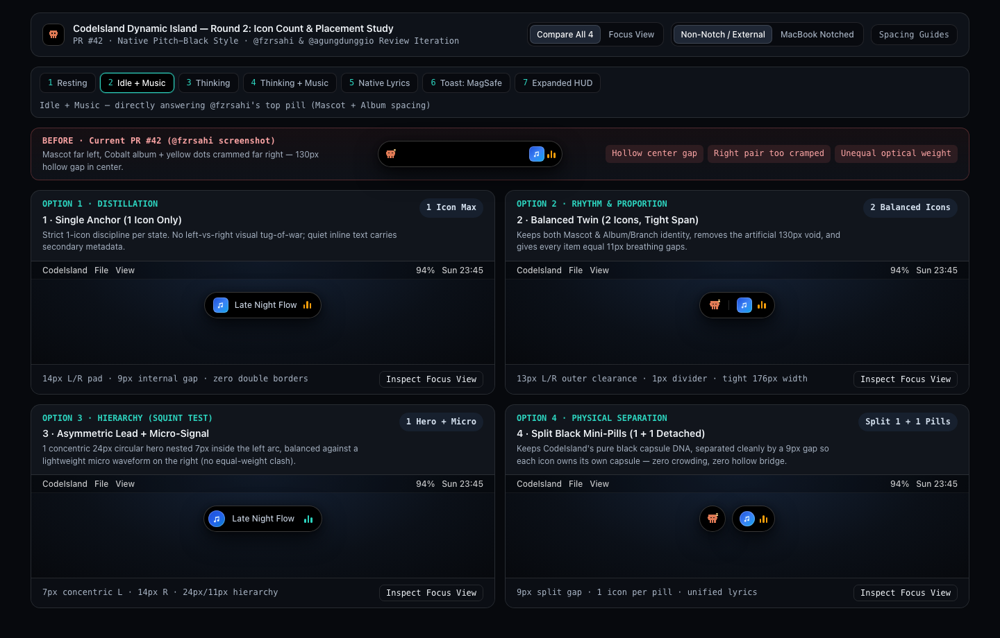
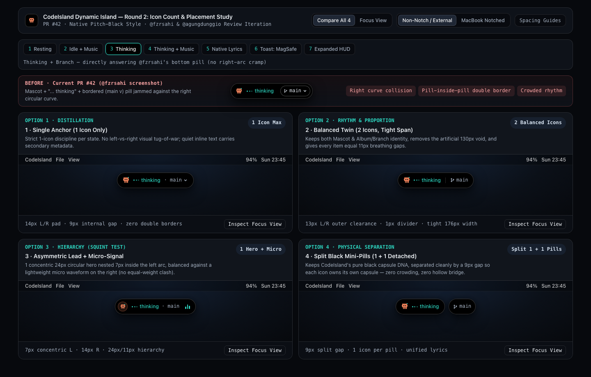
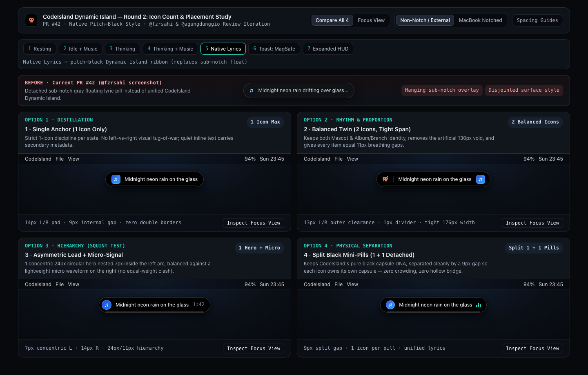
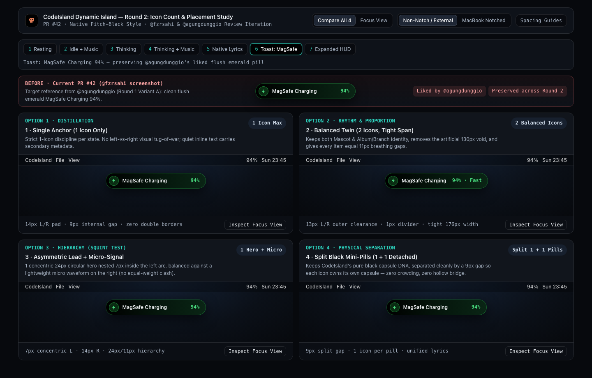
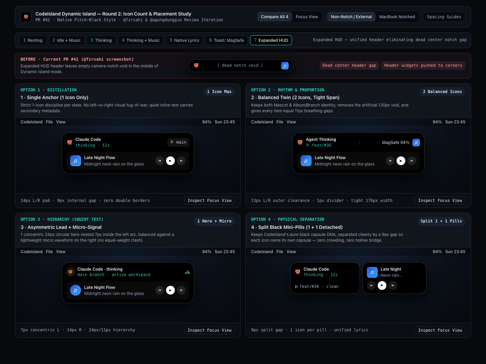
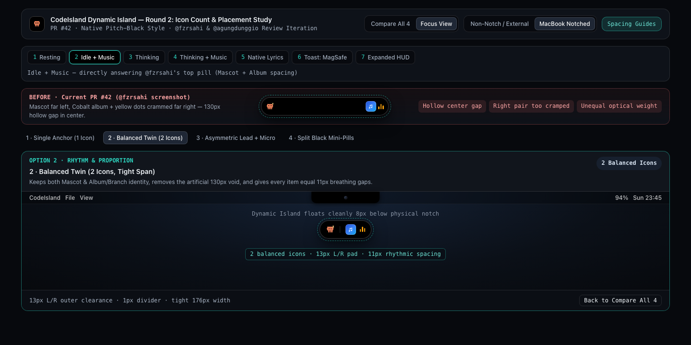
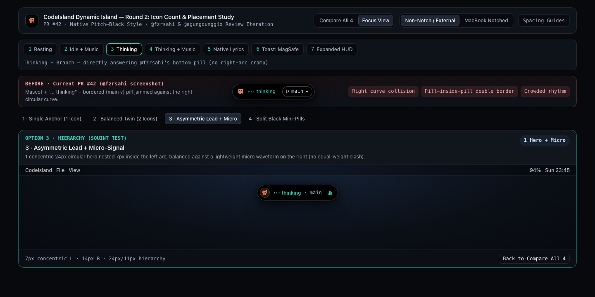
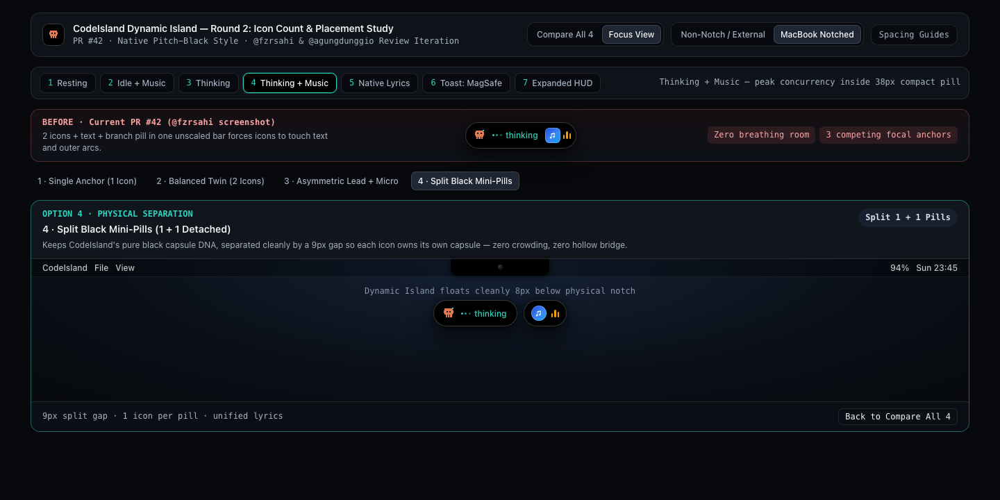

# Issue #36 — Dynamic Island Mode Design Prototype (Round 2: Icon Count & Placement Study)

Interactive HTML/CSS prototype for **PR #42** (`feat/#36-notch-dynamic-island-mode`), iterating directly on **Round 1 review feedback** from [`@fzrsahi`](https://github.com/fzrsahi/CodeIsland/pull/42#issuecomment-6897177211) and [`@agungdunggio`](https://github.com/fzrsahi/CodeIsland/pull/42#issuecomment-6897204812).

## What Changed in Round 2

- **Preserves CodeIsland's native aesthetic**: Pitch-black `#000000` continuous pill, subtle white hairline rim (`22%`), pixel terracotta mascot (`#E07A55`), cyan thinking indicator (`#2DD4BF`), cobalt album art, and [`@agungdunggio`](https://github.com/fzrsahi/CodeIsland/pull/42#issuecomment-6897204812)'s flush emerald **`MagSafe Charging · 94%`** toast. Foreign editorial/cassette themes from Round 1 were removed.
- **Targets the exact spatial flaws flagged by `@fzrsahi`**:
  1. **Idle + Music (`Top Bar`)**: Eliminates the awkward `~130px` hollow black void between left mascot and right album+dots.
  2. **Thinking (`Bottom Bar`)**: Removes pill-inside-pill `(main v)` double-border clamping against the right circular arc.
  3. **Native Lyrics & Expanded HUD**: Integrates synced lyrics inside the pitch-black capsule (replacing hanging sub-notch bars) and unifies the Expanded HUD header with zero dead camera-notch gap.

## 4 Round 2 Icon Count & Placement Options

| Option | Strategy | Icon Count | Key Difference |
| :--- | :--- | :--- | :--- |
| **1 · Single Anchor** | Strict Impeccable distillation | **1 icon max** | Drops competing right-hand squares; quiet inline typography carries track/branch info (`14px` L/R padding). |
| **2 · Balanced Twin** | Symmetrical proportion & hairline rhythm | **2 balanced icons** | Keeps both Mascot + Album/Branch identity inside a tight proportional pill with equal `11px` gaps and `1px` divider. |
| **3 · Asymmetric Lead + Micro** | Clear visual hierarchy (squint test) | **1 concentric 24px hero + micro signal** | Nests one circular `24px` anchor concentrically (`7px` inset) on the left curve, balanced against lightweight trailing wave bars. |
| **4 · Split Black Mini-Pills** | Physical icon separation | **Split 1 + 1 capsules** | Same `#000000` pill styling detached across a `9px` desktop gap so icons never crowd and naturally adapt below/around notches. |

## Preview Gallery

### Idle + Music (Before vs 4 Options)


### Thinking + Branch (Before vs 4 Options)


### Native Lyrics (Integrated Pitch-Black Ribbon)


### MagSafe Toast (`@agungdunggio` Style) & Expanded HUD

| MagSafe Charging 94% | Unified Expanded HUD |
| :---: | :---: |
|  |  |

### Focus Stage Previews (Notched & Spacing Guides)

| Balanced Twin · MacBook Notched (Guides ON) | Asymmetric Lead + Micro (Non-Notch) | Split Black Mini-Pills · MacBook Notched |
| :---: | :---: | :---: |
|  |  |  |

## Try the Interactive Prototype Locally

Open directly in any browser (no build step or external assets required):

```bash
open docs/proposals/issue-36-dynamic-island/dynamic-island-prototype.html
```

Controls available inside the prototype:
- **Compare All 4 / Focus View** switcher
- **Non-Notch / External** vs **MacBook Notched** hardware toggle
- **7 interactive states** (keyboard shortcuts `1`–`7`)
- **Spacing Guides** toggle (shortcut `G`) highlighting concentric outer padding and icon slots
