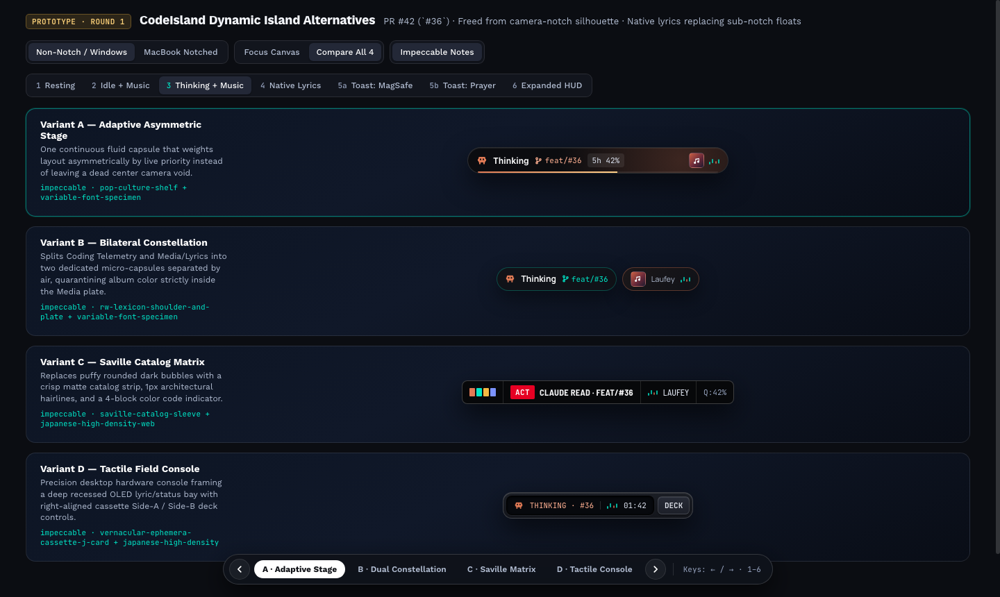
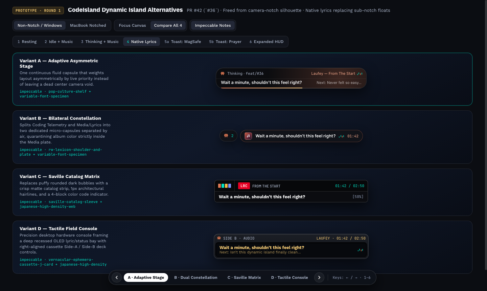
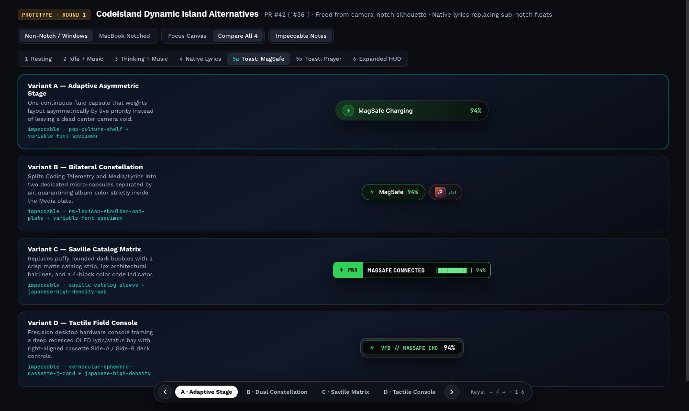
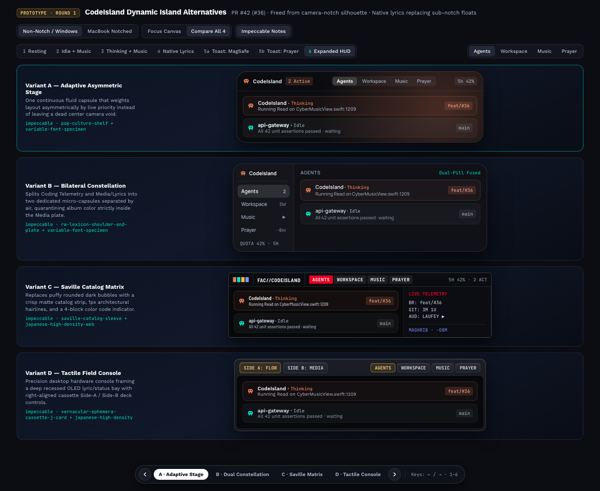
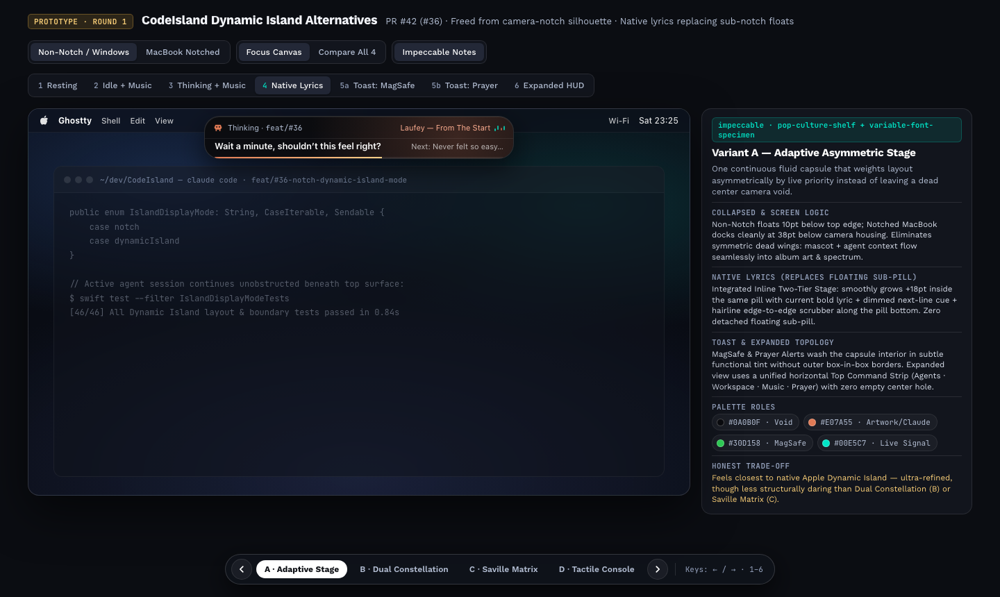
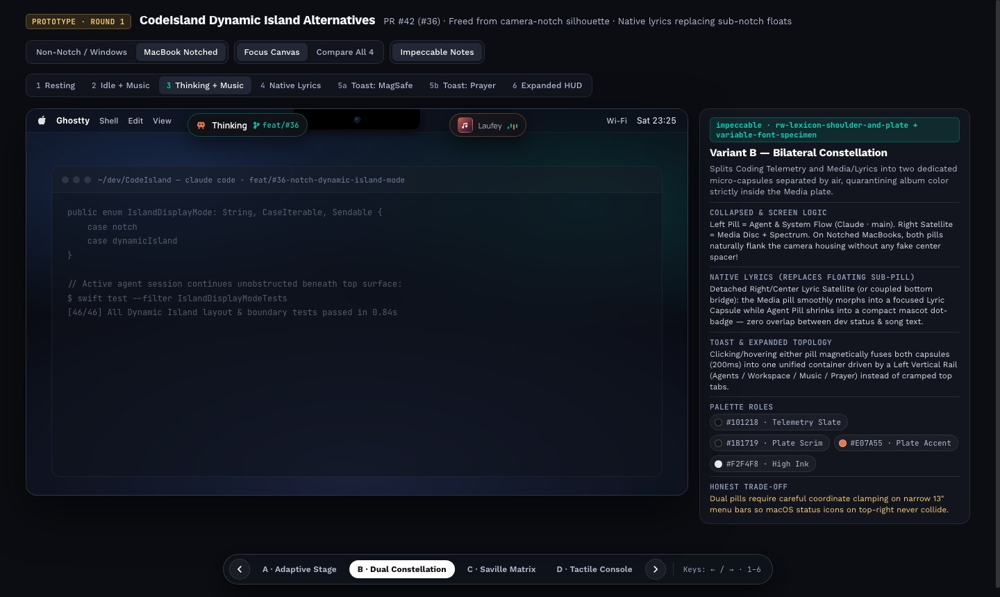
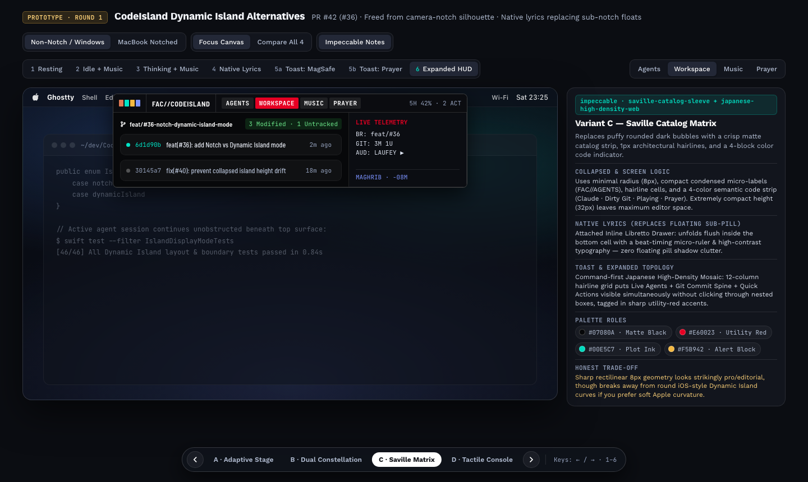
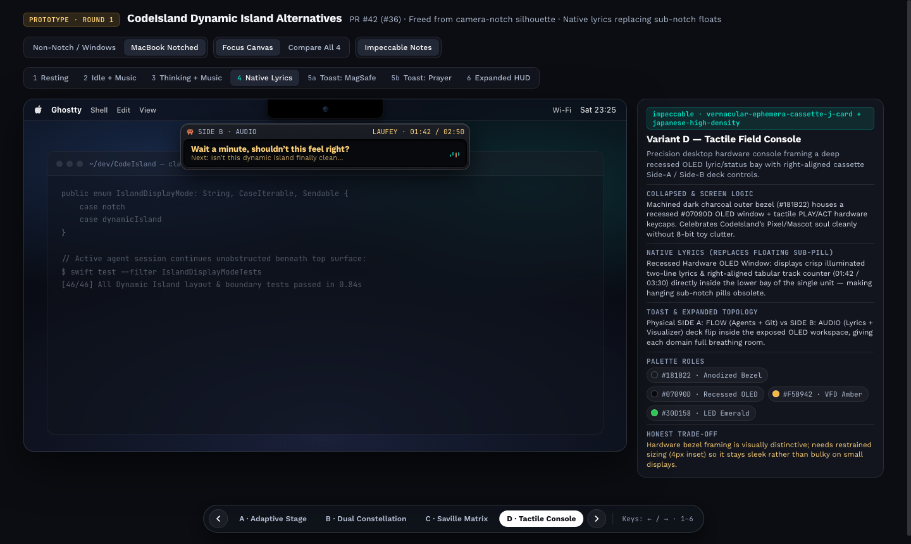

# Issue #36 — Dynamic Island UI Design Alternatives (Round 1 Review Artifact)

> **Catatan PR Artifact:** Direktori `docs/proposals/issue-36-dynamic-island/` ini sengaja ditambahkan ke branch `feat/#36-notch-dynamic-island-mode` sebagai **artefak diskusi UI** untuk direview oleh `@fzrsahi`. Setelah arah desain final disepakati dan diimplementasikan di SwiftUI, folder proposal sementara ini dapat dibersihkan sebelum merge ke `main`.

---

## Konteks Masalah pada Implementasi PR #42 Sebelumnya (`6d1d90b`)

Menindaklanjuti masukan `@fzrsahi` (`pullrequestreview-5911189205`, `issuecomment-6895860854`, dan `issuecomment-6895909035`):
1. **Tidak perlu terpaku pada desain notch fisik:** Implementasi Dynamic Island sebelumnya masih memisahkan sayap kiri & kanan dengan ruang kosong mati di tengah, sehingga tampak canggung baik di layar non-notch maupun ber-notch.
2. **Box-inside-box toast:** Banner `MagSafeChargingBanner` / `PrayerMiniPeekBannerView` menghasilkan ruang header hitam kosong di atas kartu ber-border terpisah.
3. **Expanded header terbelah gap tengah:** Tab header di panel expanded terpisah oleh sisa lebar cutout notch.
4. **Floating sub-notch lyrics tidak relevan lagi:** Presets sub-notch dulu dibuat agar lirik tidak tertutup notch kamera hardware; pada mode Dynamic Island, lirik dirancang langsung menjadi bagian organik dari arsitektur Dynamic Island-nya sendiri.

---

## Cara Membuka Prototype Interaktif Secara Lokal

Buka file HTML standalone berikut langsung di browser (Chrome / Safari / Brave / Arc) setelah pull branch ini:

```bash
open docs/proposals/issue-36-dynamic-island/dynamic-island-prototype.html
```

**Kontrol di dalam Prototype:**
- **`←` / `→`** atau pill di bawah layar: berpindah antar **Varian A, B, C, D**.
- **Tombol `1`–`6`**: loncat cepat ke semua state nyata CodeIsland (`Resting`, `Idle + Music`, `Thinking + Music`, `Native Lyrics`, `Toast: MagSafe`, `Toast: Prayer`, `Expanded HUD`).
- **Toggle `Non-Notch / Windows` vs `MacBook Notched`**: menguji perilaku tiap varian pada layar datar/eksternal/Windows maupun MacBook dengan kamera notch fisik (tanpa idle green webcam dot).
- **Toggle `Compare All 4`**: membandingkan siluet ke-4 varian sekaligus dalam satu state.

---

## Ringkasan 4 Alternatif Arsitektural (Impeccable Seed `seed:df74936d0f2b7f06`)

| Varian | Referensi Dunia Impeccable | Konsep Utama & Topologi Collapsed | Mekanisme Lirik Native (Pengganti Sub-Notch Float) | Morph Toast & Arsitektur Expanded |
| :--- | :--- | :--- | :--- | :--- |
| **A — Adaptive Asymmetric Stage** | [`pop-culture-shelf-vertical-video-feed-surface`](https://impeccable.style/worlds/cards/pop-culture-shelf-vertical-video-feed-surface.webp) + [`variable-font-specimen`](https://impeccable.style/worlds/cards/variable-font-specimen.webp) | **Satu kapsul fluid asimetris** tanpa spacer kosong di tengah. Di Non-Notch melayang `10pt`; di MacBook Notched turun rapi `38pt` tepat di bawah kamera. Warna album art merembes halus (`radial scrim`) di sisi media. | **Inline Two-Tier Stage**: kapsul meninggi `+18pt` menyatu (Atas: agen + track; Bawah: lirik aktif bold + next cue + **hairline progress scrubber di dasar pill**). | Toast mewarnai interior kapsul secara menyatu (`MagSafe` hijau / `Prayer` indigo) tanpa nested card. Expanded memakai **Unified Top Command Strip** tanpa gap tengah. |
| **B — Bilateral Constellation** | [`rw-lexicon-shoulder-and-plate`](https://impeccable.style/worlds/cards/rw-lexicon-shoulder-and-plate.webp) + [`variable-font-specimen`](https://impeccable.style/worlds/cards/variable-font-specimen.webp) | **Dual-Pill Split System**: kapsul kiri untuk *Coding Flow* (`Thinking · feat/#36`) dan satelit kanan terpisah untuk *Media Plate*. Di MacBook Notched, kedua pill **mengapit kamera fisik** secara natural tanpa ruang mati. | **Lyric Satellite Takeover**: saat lirik aktif, pill Agent mengecil jadi badge mascot ringkas, sementara satelit kanan melebar menjadi kapsul lirik beresolusi tinggi dengan timestamp. | Toast hanya melebarkan kapsul terkait sambil tetap menjaga sisi lain terbaca. Saat Expanded, kedua kapsul menyatu menjadi panel dengan **Left Vertical Navigation Rail**. |
| **C — Saville Catalog Matrix** | [`brand-identity-canon-saville-catalog-sleeve`](https://impeccable.style/worlds/cards/brand-identity-canon-saville-catalog-sleeve.webp) + [`japanese-high-density-web`](https://impeccable.style/worlds/cards/japanese-high-density-web.webp) | Menolak pill membulat generik: **matte catalog strip** (`8px` radius, tinggi tipis `32px`) bersekat `1px` hairline + **4-block semantic status strip** (`Agent · Git · Audio · Prayer`) dan micro-badge *utility red*. | **Attached Inline Libretto Drawer**: drawer lirik membuka rata tepat di sel bawah strip utama disertai indikator persen progress, tanpa kartu melayang terpisah. | Toast hadir sebagai full-width coded banner (`PWR // MAGSAFE [█████████░] 94%`). Expanded memakai **12-Column Dense Grid** menampilkan list utama & panel *Live Telemetry* berdampingan. |
| **D — Tactile Field Console** | [`vernacular-ephemera-cassette-j-card`](https://impeccable.style/worlds/cards/vernacular-ephemera-cassette-j-card.webp) + [`japanese-high-density-web`](https://impeccable.style/worlds/cards/japanese-high-density-web.webp) | Mengangkat identitas *pixel/hardware console* CodeIsland menjadi lebih matang: bezel anodized tipis membingkai **recessed OLED display bay** + tombol keycap fisik (`DECK`, `SIDE A/B`) dan timing rata kanan presisi. | **Recessed OLED Two-Line Readout**: lirik + next cue dengan kilau VFD amber hangat tampil langsung di bay OLED internal bersama counter `01:42 / 02:50` rata kanan. | Toast mengaktifkan tampilan VFD emerald/indigo di dalam bay OLED. Expanded mengadopsi pemisahan **`SIDE A: FLOW` (Agents + Git)** dan **`SIDE B: MEDIA` (Audio + Prayer)**. |

---

## Visual Previews (Chromium High-DPI Captures)

### 1. Side-by-Side Comparison (`Compare All 4`)

| State: Thinking + Music | State: Native Lyrics |
| :---: | :---: |
|  |  |

| State: MagSafe Toast Morph | State: Expanded HUD |
| :---: | :---: |
|  |  |

---

### 2. Focus Desktop Previews (`Non-Notch / Windows` vs `MacBook Notched`)

| Variant A · Native Lyrics (Non-Notch / Windows) | Variant B · Dual Pills mengapit Notch MacBook |
| :---: | :---: |
|  |  |

| Variant C · Dense Workspace Expanded (Non-Notch) | Variant D · Recessed OLED Lyrics (MacBook Notched) |
| :---: | :---: |
|  |  |

---

## Poin Diskusi untuk `@fzrsahi` (Round 1 -> Round 2)

1. Dari siluet **A**, **B**, **C**, dan **D**, arah mana yang paling cocok dengan karakter **CodeIsland**?
2. Apakah ingin me-remix elemen dari varian berbeda (misalnya: **Dual-Pill B saat collapsed** + **Adaptive Stage A saat Lyrics** + **Dense Telemetry C saat Expanded**)?
3. Untuk tema existing (`Modern Clean` vs `16-bit Pixel`), apakah nanti kita pakai **1 struktur pemenang** dengan token adaptif untuk kedua tema tersebut?
